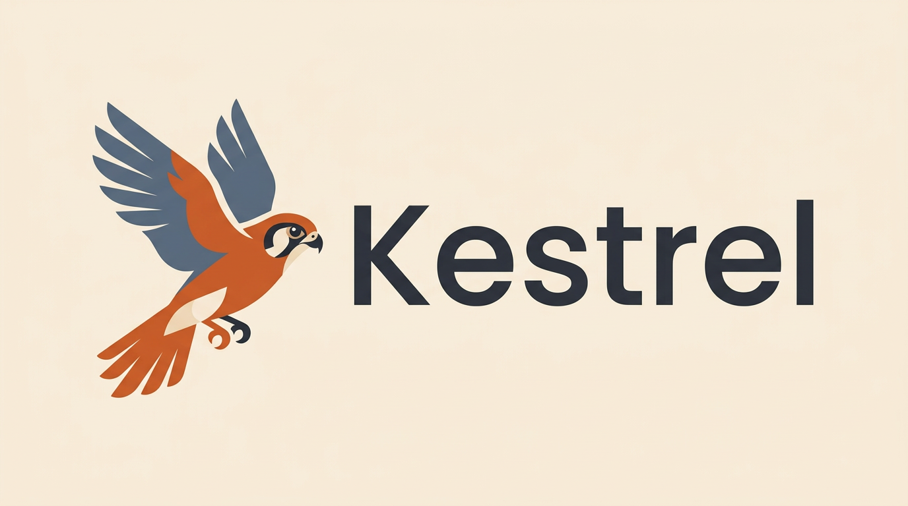

<p align="center">
  
</p>

<h1 align="center">Kestrel</h1>

<p align="center"><em>The patient hunter for your job search — it hovers over the whole field, strikes once, and you hold the final call.</em></p>

<p align="center">
  <a href="#how-it-works">How it works</a> ·
  <a href="#requirements">Requirements</a> ·
  <a href="#get-started">Get started</a> ·
  <a href="#your-keys-your-data">Your keys, your data</a> ·
  <a href="#contributing">Contribute</a>
</p>

<p align="center">
  <a href="LICENSE"></a>
  <a href="https://www.python.org/downloads/"></a>
  <a href="https://github.com/Pickle-Pixel/ApplyPilot"></a>
</p>

---

Kestrel is an **agent-native job-application pipeline**. Your coding agent — the one already open in your editor — drives the whole flow over a JSON protocol: it conducts onboarding, scores jobs against your resume, tailors your documents, drafts cover letters, and reports application outcomes. Kestrel holds the state, validation, and guardrails; your agent supplies the intelligence. On that route there is **no LLM API key, no Node.js, and no browser automation stack to install** — page fetching included, because your agent's own browser covers it.

The older routes still work, on top of the same core: **provider-backed mode** (a configured API key does the scoring and tailoring — any OpenAI-compatible endpoint, including a local server) and the **built-in browser engine** (optional `[browser]` extra) as a fallback for scraping and PDF rendering.

> **Fork of record.** Kestrel is a fork of [ApplyPilot](https://github.com/Pickle-Pixel/ApplyPilot) by Pickle-Pixel, first published February 17, 2026. Upstream copyright notices are retained per the AGPL-3.0; see [NOTICE](NOTICE). We are not affiliated with applypilot.app, useapplypilot.com, or any other product using the "ApplyPilot" name.

---

## How it works

| Stage | What happens |
|-------|--------------|
| **1. Discover** | Scrapes Indeed, LinkedIn, Glassdoor, ZipRecruiter, and Google Jobs, plus Workday employer portals and direct career sites. Optional Composio source for web3.career. Deduplicates by URL. |
| **2. Enrich** | Fetches the full description for every job: JSON-LD structured data first, CSS selectors next, smart extraction as the fallback tier. On the agent route, your agent's browser does the fetching. |
| **3. Score** | Every job is rated 1–10 against your resume and preferences — by your driving agent, or by a configured LLM in provider mode. Only jobs above your threshold proceed. |
| **4. Tailor** | Your resume is reworked per job — reorganized, relevant experience emphasized, keywords incorporated. Your declared resume facts are preserved exactly; a typed fabrication guard refuses anything not in the resume. |
| **5. Cover letter** | A targeted letter per job, referencing the specific company, role, and your mapped experience. |
| **6. Apply** | Applications are bookkept by Kestrel: a per-job apply lock, a plan-then-confirm gate in front of every real submission, and a daily application cap. Your agent (or the built-in engine) drives the browser; nothing is submitted until a human confirms. |

Each stage is independent: run all six, or pick the ones you want.

**Human-gated by design.** Real submissions require an explicit plan-then-confirm step (`kestrel apply --plan` → `--i-confirm <hash>`, or the `prepared` outcome on the agent route), a per-day application cap, and terminal CAPTCHA handling that never retries blocked applications.

## Requirements

| Component | Required for | Details |
|-----------|-------------|---------|
| Python 3.11+ | Everything | The only core requirement |
| An LLM API key | *Optional* — unattended provider mode | Only if you want Kestrel to call an LLM itself for scoring/tailoring/cover letters: Gemini, OpenAI, or any OpenAI-compatible endpoint, including local (Ollama, llama.cpp) |
| Node.js 18+ + Chrome/Chromium | *Optional* — built-in fallback engine | Only for the built-in Playwright apply engine and built-in page scraping: install `pip install 'kestrel-agent[browser]'`, then `playwright install chromium`. Your agent's own browser covers page fetching on the primary route |
| Claude Code CLI | *Optional* — alternative apply engine | Install from [claude.ai/code](https://claude.ai/code); Factory Droid CLI works as an alternative |

Optional: a CapSolver key for CAPTCHAs, a Composio key for the web3.career discovery source, and a Tavily (or SerpAPI) key for hiring-lead discovery — see [Hiring-lead discovery](#hiring-lead-discovery-optional-bring-a-tavily-key).

## Get started

### Agent mode (recommended): drive Kestrel with your coding agent

Python 3.11+ is all you need:

```bash
pip install kestrel-agent
kestrel agent start --mode agent   # opens intake — no API key, no Playwright
```

Then run the loop from your agent chat. Every verb prints exactly one JSON document on stdout:

```bash
kestrel agent next                 # the authoritative next payload: phase, agenda, what to do
kestrel agent send --text "..."    # one agent-led interview turn; the reply rides the payload
kestrel agent answer --question <id> --choice <value>   # guided answers (--free-text / --skip too)
kestrel agent confirm              # commit the reviewed profile
```

Once a resume is queued, the interview runs in agent mode — your agent composes the turns, Kestrel records them. Then the pipeline:

```bash
kestrel agent job-next --stage score    # next pending job with the scoring rubric and progress
kestrel agent score --url <url> --score 8 --reasoning "..."   # persist your score + keywords + reasoning
kestrel agent job-next --stage tailor   # next job with a typed data template to fill
kestrel agent tailor --url <url> --data @template.json        # fabrication guard enforced
kestrel agent job-next --stage cover    # then kestrel agent cover --url <url> --text "..."
kestrel agent apply-acquire            # take the per-job apply lock (claim token at job.claim)
kestrel agent apply-result --url <url> --status applied --claim <token>
```

Open the job URL from a payload with your agent's own browser to read the posting and drive the application form — Kestrel tracks the lock and the outcome. `--status prepared` is the honest checkpoint for "materials ready, stopped at the human-confirmation gate": it does not count toward the daily cap and keeps the lock until the same claim reports the final outcome.

### Unattended mode (optional): bring an API key

If you want Kestrel to run the thinking stages itself, set up a provider and run the classic pipeline:

```bash
kestrel init          # one-time setup: resume, profile, preferences, API keys
kestrel doctor        # verify your setup — shows what's installed and what's missing
kestrel run           # discover → enrich → score → tailor → cover letters
kestrel apply         # browser-driven application (plan-then-confirm gated)
kestrel portal        # optional: localhost web cockpit at http://127.0.0.1:8765
```

### Built-in browser engine (optional fallback)

The `[browser]` extra adds Playwright for Kestrel's own page scraping (smart-extract, detail enrichment) and PDF rendering — useful when no agent browser is around:

```bash
pip install 'kestrel-agent[browser]'
playwright install chromium
```

Without the extra, those features exit with a message naming both routes: install the extra, or let your agent's browser fetch the page. The built-in apply engines are unchanged.

### Hiring-lead discovery (optional): bring a Tavily key

Once jobs are scored, Kestrel can find the people who do the hiring at your high-scoring companies and hand you their profile cards. The connection itself is always yours: Kestrel never sends messages or connection invites, never touches your LinkedIn account, and never fetches profile pages — discovery reads search-result metadata (titles, URLs, snippets) only.

The default search provider is [Tavily](https://www.tavily.com). To set one up:

1. Create a free account at [app.tavily.com](https://app.tavily.com). The documented free tier covers 1,000 credits a month, and one discovery query per company costs a single credit — a full discovery run over your high-match companies typically costs well under ten.
2. Copy your API key (it starts with `tvly-`).
3. Add it to your Kestrel env file (kept owner-only under your data directory):

   ```bash
   echo 'TAVILY_API_KEY=tvly-your-key-here' >> ~/.kestrel/.env
   ```

Then, from your agent chat:

```bash
kestrel agent leads-discover        # one search per high-match company
kestrel agent leads-list --reveal   # the profile cards — open them yourself
```

Results that don't name your company in their title or snippet are dropped and counted in the run's `dropped_no_affiliation` field. Prefer SerpAPI instead? Set `SERP_API_KEY` in the same file and `provider: serp` in `~/.kestrel/leads.yaml`. What each provider receives — and what never leaves your machine — is tabulated in [PRIVACY.md](PRIVACY.md).

### From source

```bash
git clone https://github.com/Vontarius-Ventures/kestrel.git
cd kestrel
pip install -e ".[dev]"   # dev includes the [browser] extra
playwright install chromium
```

> **Note:** `python-jobspy` pins an exact numpy version in its metadata that conflicts with pip's resolver, but works fine with any modern numpy at runtime. If `pip install kestrel-agent` fails to resolve, install it separately: `pip install --no-deps python-jobspy`, then reinstall its runtime deps (`pydantic tls-client requests markdownify regex`).

## Your keys, your data

- Everything lives on your machine: job state in a local SQLite database under `~/.kestrel`, configuration in `~/.kestrel/.env` (created owner-only, mode 0600).
- **Agent mode sends nothing anywhere** — there are no AI calls at all. The reasoning happens in your own agent's context; only ordinary requests to the job boards themselves leave the machine.
- Keys stay local. In provider mode, LLM calls send your resume text, profile data, and job descriptions to whichever provider *you* configure — point `LLM_URL` at a local endpoint (Ollama, llama.cpp) and nothing AI-related leaves your machine.
- The web portal binds to `127.0.0.1` only, requires a generated token, and never renders secrets back to the page.
- Where each connected provider gets data — and what never leaves the machine — is tabulated in [PRIVACY.md](PRIVACY.md). The threat model and security practices are in [SECURITY.md](SECURITY.md).

## Contributing

Kestrel is an AGPL-3.0 fork and welcomes contributions. See [CONTRIBUTING.md](CONTRIBUTING.md) for development setup, the must-pass gates (`pytest`, `ruff check`), and ground rules.

---

AGPL-3.0 · [License](LICENSE) · [Notice](NOTICE) · Forked from [Pickle-Pixel/ApplyPilot](https://github.com/Pickle-Pixel/ApplyPilot) — upstream copyright retained.
